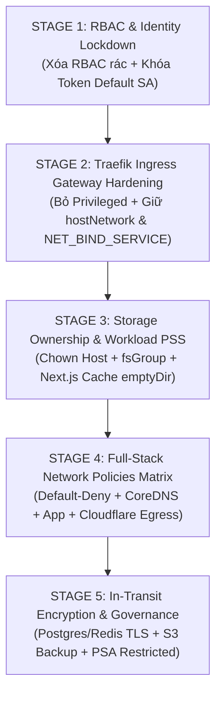

# KẾ HOẠCH CHI TIẾT TRIỂN KHAI GIA CỐ BẢO MẬT CỤM KUBERNETES (K8S SECURITY HARDENING PLAN)

> **Tài liệu tham chiếu:** [SECURITY_AUDIT_REPORT.md](./SECURITY_AUDIT_REPORT.md)  
> **Ngày cập nhật gần nhất:** 2026-10-24 (Bổ sung Stage 7: Bản vá khẩn cấp Node.js Runtime CVE-2026-111497, CVE-2026-105482, CVE-2026-105483, CVE-2026-109924)  
> **Mục tiêu:** Khắc phục toàn bộ các lỗ hổng bảo mật đã kiểm toán (Traefik Privileged, Flat Network, RBAC rác, Default SA Automount, Workload SecurityContext, Node.js RCE/DoS) với nguyên tắc **Zero Downtime** và **bảo toàn 100% tính liên tục của dịch vụ**.  
> **Nguyên tắc cốt lõi:** Các thành phần có sự phụ thuộc mật thiết lẫn nhau (interdependent) được gom trọn gói vào cùng một Stage để triệt tiêu nguy cơ phát sinh lỗi gián đoạn.

---

## 🗺️ MA TRẬN CÁC GIAI ĐOẠN & MỨC ĐỘ PHỤ THUỘC



| Giai đoạn | Trọng tâm công việc | Thời gian thực hiện | Rủi ro Downtime | Môi trường áp dụng |
| :--- | :--- | :---: | :---: | :--- |
| **Stage 1** | RBAC Clean-up & Default SA Token Lockdown | 1 Giờ | 🟢 0% | Toàn cụm (Cluster-wide) |
| **Stage 2** | Traefik Ingress Controller Hardening | 2 Giờ | 🟢 Thấp | Namespace `infra` |
| **Stage 3** | Storage Permissions & Workload SecurityContext | 1 Ngày | 🟡 Trung bình | `blog-staging` ➔ `blog-prod` |
| **Stage 4** | Ma trận NetworkPolicies Micro-segmentation | 1 - 2 Ngày | 🔴 Cao (nếu thiếu rule) | `blog-staging` ➔ `blog-prod` |
| **Stage 5** | Data Protection, Backup S3 & PSA Restricted | 1 Tuần | 🟡 Trung bình | Toàn cụm (Cluster-wide) |

---

## 🟢 STAGE 1: DỌN DẸP QUYỀN HẠN & KHÓA TOKEN SERVICEACCOUNT (RBAC & IDENTITY)

### 1. Mục tiêu & Nguyên lý gom nhóm
* **Mục tiêu:** Triệt tiêu các quyền truy cập cấp cao còn sót lại và ngăn chặn tự động cấp phát token Kubernetes API cho các pod không sử dụng.
* **Lý do gom chung:** Các thao tác hoàn toàn thuộc tầng cấu hình API Server, không yêu cầu restart Pod ứng dụng, không làm thay đổi file descriptor hay network socket, mức độ rủi ro bằng 0.

### 2. Thành phần phụ thuộc (Dependencies)
* Không có phụ thuộc chéo. Có thể thực thi độc lập và ngay lập tức.

### 3. Các bước thực hiện chi tiết

#### Bước 1.1: Xóa các ClusterRoleBinding rác của Longhorn
Longhorn đã được gỡ bỏ khỏi cụm, cần xóa 2 binding thừa để tránh nguy cơ chiếm quyền:
```bash
kubectl delete clusterrolebinding longhorn-pre-upgrade-admin-binding --ignore-not-found
kubectl delete clusterrolebinding longhorn-support-bundle --ignore-not-found
```

#### Bước 1.2: Vô hiệu hóa tính năng Automount Token của Default ServiceAccount
Ngăn các pod chạy default SA (như `postgres-production`, `postgres-staging`, `postgres-exporter`) bị mount token API nội bộ vào `/var/run/secrets/kubernetes.io/serviceaccount/`:
```bash
kubectl patch serviceaccount default -n blog-prod -p '{"automountServiceAccountToken": false}'
kubectl patch serviceaccount default -n blog-staging -p '{"automountServiceAccountToken": false}'
kubectl patch serviceaccount default -n infra -p '{"automountServiceAccountToken": false}'
kubectl patch serviceaccount default -n monitoring -p '{"automountServiceAccountToken": false}'
kubectl patch serviceaccount default -n cert-manager -p '{"automountServiceAccountToken": false}'
```

#### Bước 1.3: Thu hồi Static Token vĩnh viễn của Dashboard
Xóa bỏ Secret token vĩnh viễn gắn với `admin-user`:
```bash
kubectl delete secret admin-user-token-permanent -n kubernetes-dashboard --ignore-not-found
```
> Khi cần truy cập Dashboard, chỉ tạo token tạm thời có thời hạn 1 giờ:
> `kubectl create token admin-user -n kubernetes-dashboard --duration=1h`

### 4. Tiêu chí nghiệm thu (Acceptance Criteria)
- [ ] `kubectl get clusterrolebindings | grep longhorn` trả về rỗng.
- [ ] `kubectl get sa default -n blog-prod -o jsonpath='{.automountServiceAccountToken}'` trả về `false`.
- [ ] Không có bất kỳ cảnh báo lỗi nào phát sinh từ các pod đang chạy.

---

## 🟡 STAGE 2: GIA CỐ EDGE INGRESS CONTROLLER (TRAEFIK GATEWAY)

### 1. Mục tiêu & Nguyên lý gom nhóm
* **Mục tiêu:** Xóa bỏ chế độ `privileged: true` trên Ingress Controller tiếp nhận traffic từ Internet, ngăn chặn hoàn toàn nguy cơ Node Root Compromise.
* **Lưu ý sống còn:** 
  - VPS chạy k8s là môi trường bare-metal/đơn lẻ không có Cloud Load Balancer (AWS ALB / GCP LB).
  - **BẮT BUỘC GIỮ `hostNetwork: true`** để Traefik lắng nghe trực tiếp trên IP public của VPS ở cổng 80 và 443.
  - Traefik chỉ cần capability `NET_BIND_SERVICE` để bind cổng 80/443, **hoàn toàn không cần `privileged: true` hay `NET_ADMIN`**.

### 2. Thành phần phụ thuộc (Dependencies)
* Traefik DaemonSet, Ansible role `infra-services`, DNS routing các domain (`luumac.io.vn`, `k8s-prod.luumac.io.vn`).

### 3. Các bước thực hiện chi tiết

#### Bước 2.1: Cập nhật task Ansible trong [main.yml](../infra/ansible/roles/infra-services/tasks/main.yml)
Chỉnh sửa cấu hình Helm upgrade Traefik:
```yaml
# Đường dẫn: infra/ansible/roles/infra-services/tasks/main.yml
- name: Deploy Traefik Ingress Controller
  become_user: "{{ ansible_operator_user }}"
  command: >
    helm upgrade --install traefik traefik/traefik
    --namespace infra
    --set ports.web.port=80
    --set ports.web.hostPort=80
    --set ports.websecure.port=443
    --set ports.websecure.hostPort=443
    --set service.type=NodePort
    --set deployment.kind=DaemonSet
    --set hostNetwork=true
    --set updateStrategy.rollingUpdate.maxUnavailable=1
    --set updateStrategy.rollingUpdate.maxSurge=0
    --set podSecurityContext.runAsNonRoot=false
    --set podSecurityContext.runAsUser=0
    --set podSecurityContext.runAsGroup=0
    --set securityContext.privileged=false              # SỬA: true -> false
    --set securityContext.allowPrivilegeEscalation=false # SỬA: true -> false
    --set securityContext.capabilities.drop={ALL}        # SỬA: drop ALL
    --set securityContext.capabilities.add={NET_BIND_SERVICE} # Chỉ giữ quyền bind cổng 80/443
    --set securityContext.readOnlyRootFilesystem=false
```

#### Bước 2.2: Triển khai cập nhật Traefik
```bash
ansible-playbook -i infra/ansible/inventory/production.ini infra/ansible/playbooks/deploy-infra.yml --tags traefik
```

### 4. Tiêu chí nghiệm thu & Rollback
- [ ] Pod Traefik chuyển sang `Running (1/1)` sau khi rolling update:
  `kubectl get pods -n infra -l app.kubernetes.io/name=traefik`
- [ ] Kiểm tra securityContext container:
  `kubectl get ds traefik -n infra -o jsonpath='{.spec.template.spec.containers[0].securityContext}'` xác nhận `privileged: false`.
- [ ] Kiểm tra kết nối từ ngoài Internet:
  `curl -Iv https://luumac.io.vn` trả về HTTP 200/301.
- **Rollback:** Nếu Traefik không khởi động được, rollback lại qua lệnh:
  `helm rollback traefik -n infra` hoặc đổi lại `--set securityContext.privileged=true`.

---

## 🟠 STAGE 3: ĐỒNG BỘ STORAGE OWNERSHIP & SIẾT CHẶT WORKLOAD SECURITYCONTEXT

### 1. Mục tiêu & Nguyên lý gom nhóm
* **Mục tiêu:** Đưa toàn bộ workload ứng dụng về chuẩn **Restricted Pod Security Standard (PSS)**.
* **Lý do gom chung (Cực kỳ quan trọng):**
  1. **Storage Pair:** Xóa initContainer root `fix-permissions` **bắt buộc phải đi kèm** `podSecurityContext.fsGroup: 1001` và chạy `chown` thư mục trên host. Nếu tách riêng, container 1001 sẽ bị lỗi `EACCES: permission denied` khi upload ảnh!
  2. **ReadOnly Pair:** Bật `readOnlyRootFilesystem: true` **bắt buộc phải đi kèm** volume mount `emptyDir` vào `/tmp` và Next.js cache `/app/.next/cache`. Nếu tách riêng, Next.js và NestJS sẽ CrashLoopBackOff ngay lập tức!

### 2. Thành phần phụ thuộc (Dependencies)
* Node host filesystem (`/data/k8s/storage/backend-uploads-*`), Helm charts `backend` và `frontend`, StatefulSet `postgres-staging`.

### 3. Các bước thực hiện chi tiết

#### Bước 3.1: Đồng bộ quyền sở hữu thư mục trên Node Host
Chạy trực tiếp trên máy chủ Kubernetes:
```bash
sudo chown -R 1001:1001 /data/k8s/storage/backend-uploads-prod
sudo chown -R 1001:1001 /data/k8s/storage/backend-uploads-staging
```

#### Bước 3.2: Cập nhật Helm Chart Backend ([../infra/apps/backend/templates/deployment.yaml](../infra/apps/backend/templates/deployment.yaml))
1. Xóa bỏ initContainer `fix-permissions` (`runAsUser: 0`).
2. Giữ nguyên initContainer `prisma-migrate`.
3. Bổ sung `emptyDir` mount vào `/tmp` và cấu hình securityContext:
```yaml
spec:
  template:
    spec:
      serviceAccountName: {{ include "backend.fullname" . }}-sa
      automountServiceAccountToken: false
      securityContext:
        runAsUser: 1001
        runAsGroup: 1001
        fsGroup: 1001
        fsGroupChangePolicy: "OnRootMismatch"
        runAsNonRoot: true
      initContainers:
      - name: prisma-migrate
        image: "{{ .Values.image.repository }}:{{ .Values.image.tag }}"
        # ... giữ nguyên prisma migration
      containers:
      - name: {{ .Chart.Name }}
        securityContext:
          allowPrivilegeEscalation: false
          readOnlyRootFilesystem: true
          capabilities:
            drop:
            - ALL
          seccompProfile:
            type: RuntimeDefault
        volumeMounts:
        - name: uploads-storage
          mountPath: /app/uploads
        - name: tmp-volume
          mountPath: /tmp
      volumes:
      - name: tmp-volume
        emptyDir: {}
```

#### Bước 3.3: Cập nhật Helm Chart Frontend ([../infra/apps/frontend/templates/deployment.yaml](../infra/apps/frontend/templates/deployment.yaml))
Bổ sung `readOnlyRootFilesystem: true` kèm `emptyDir` cho `/tmp` và Next.js build cache:
```yaml
    spec:
      securityContext:
        runAsNonRoot: true
        runAsUser: 1001
        runAsGroup: 1001
      containers:
      - name: {{ .Chart.Name }}
        securityContext:
          allowPrivilegeEscalation: false
          readOnlyRootFilesystem: true
          capabilities:
            drop:
            - ALL
          seccompProfile:
            type: RuntimeDefault
        volumeMounts:
        - name: tmp-volume
          mountPath: /tmp
        - name: next-cache
          mountPath: /app/.next/cache
      volumes:
      - name: tmp-volume
        emptyDir: {}
      - name: next-cache
        emptyDir: {}
```

#### Bước 3.4: Bổ sung Resource Limits cho `postgres-staging`
Thêm vào StatefulSet `postgres-staging`:
```yaml
resources:
  requests:
    cpu: 100m
    memory: 256Mi
  limits:
    cpu: 500m
    memory: 512Mi
```

#### Bước 3.5: Pin Image Tag cố định
* Sửa `postgres-exporter`: Đổi từ `latest` sang tag cố định (ví dụ: `v0.15.0`).
* Sửa `redis`: Đổi từ `latest` sang tag cố định (ví dụ: `7.2.4-debian-12-r8`).

### 4. Quy trình triển khai & Kiểm tra nghiệm thu
1. **Triển khai Staging:** Cập nhật repo GitOps và sync ứng dụng trên **`blog-staging`**.
2. **Kiểm tra chức năng Staging:**
   - [ ] Backend và Frontend pod chuyển sang `Running` (không dính lỗi CrashLoopBackOff vì readOnlyRootFilesystem).
   - [ ] Vào trang quản trị upload 1 file ảnh -> File lưu thành công vào PVC mà không gặp lỗi permission.
   - [ ] F5 trang blog bài viết -> SSR cache ghi bình thường vào `/app/.next/cache`.
3. **Triển khai Production:** Sync sang **`blog-prod`** sau khi Staging đạt kiểm thử 100%.

---

## 🔴 STAGE 4: PHÂN ĐOẠN MẠNG TOÀN DIỆN (NETWORK POLICIES MATRIX)

### 1. Mục tiêu & Nguyên lý gom nhóm
* **Mục tiêu:** Xóa bỏ hoàn toàn mạng phẳng (Flat Network) bằng chính sách Default-Deny, ngăn chặn nguy cơ xâm nhập ngang (Lateral Movement).
* **Lý do gom chung (Sống còn):**
  - Không thể bật Default-Deny đơn lẻ mà **bắt buộc phải áp dụng trọn vẹn một ma trận quy tắc (Rule Matrix)** cùng một lúc.
  - Nếu thiếu rule Egress port 443 ra ngoài Internet: **Backend sẽ không thể verify Cloudflare Turnstile Captcha (User không đăng nhập được)** và **không thể upload file lên Cloudflare R2**.
  - Nếu thiếu rule CoreDNS port 53: Mọi kết nối nội bộ bằng domain K8s Service sẽ bị timeout.

### 2. Thành phần phụ thuộc (Dependencies)
* Cilium CNI, CoreDNS, Traefik, Frontend, Backend, Postgres, Redis, Cloudflare Turnstile & R2 endpoints.

### 3. File Manifest Ma trận NetworkPolicy: `infra/network-policies/blog-prod-matrix.yaml`
```yaml
# ==============================================================================
# RULE 1: DEFAULT DENY TOÀN BỘ TRAFFIC VÀO VÀ RA KHỎI NAMESPACE
# ==============================================================================
apiVersion: networking.k8s.io/v1
kind: NetworkPolicy
metadata:
  name: default-deny-all
  namespace: blog-prod
spec:
  podSelector: {}
  policyTypes:
  - Ingress
  - Egress
---
# ==============================================================================
# RULE 2: CHO PHÉP MỌI POD TRUY VẤN DNS NỘI BỘ (COREDNS)
# ==============================================================================
apiVersion: networking.k8s.io/v1
kind: NetworkPolicy
metadata:
  name: allow-dns-egress
  namespace: blog-prod
spec:
  podSelector: {}
  policyTypes:
  - Egress
  egress:
  - to:
    - namespaceSelector: {}
      podSelector:
        matchLabels:
          k8s-app: kube-dns
    ports:
    - protocol: UDP
      port: 53
    - protocol: TCP
      port: 53
---
# ==============================================================================
# RULE 3: CHO PHÉP TRAEFIK (TỪ NAMESPACE INFRA) GỌI VÀO FRONTEND VÀ BACKEND
# ==============================================================================
apiVersion: networking.k8s.io/v1
kind: NetworkPolicy
metadata:
  name: allow-traefik-ingress
  namespace: blog-prod
spec:
  podSelector:
    matchExpressions:
    - key: app
      operator: In
      values: [portfolio-frontend-production, portfolio-backend-production]
  policyTypes:
  - Ingress
  ingress:
  - from:
    - namespaceSelector:
        matchLabels:
          kubernetes.io/metadata.name: infra
---
# ==============================================================================
# RULE 4: CHO PHÉP FRONTEND KẾT NỐI VÀO BACKEND (PORT 3001)
# ==============================================================================
apiVersion: networking.k8s.io/v1
kind: NetworkPolicy
metadata:
  name: allow-frontend-to-backend
  namespace: blog-prod
spec:
  podSelector:
    matchLabels:
      app: portfolio-backend-production
  policyTypes:
  - Ingress
  ingress:
  - from:
    - podSelector:
        matchLabels:
          app: portfolio-frontend-production
    ports:
    - protocol: TCP
      port: 3001
---
# ==============================================================================
# RULE 5: CHO PHÉP BACKEND KẾT NỐI VÀO POSTGRES (5432) VÀ REDIS (6379)
# ==============================================================================
apiVersion: networking.k8s.io/v1
kind: NetworkPolicy
metadata:
  name: allow-backend-to-databases
  namespace: blog-prod
spec:
  podSelector:
    matchExpressions:
    - key: app.kubernetes.io/name
      operator: In
      values: [postgres, redis]
  policyTypes:
  - Ingress
  ingress:
  - from:
    - podSelector:
        matchLabels:
          app: portfolio-backend-production
    ports:
    - protocol: TCP
      port: 5432
    - protocol: TCP
      port: 6379
---
# ==============================================================================
# RULE 6: CHO PHÉP BACKEND KẾT NỐI NỘI BỘ VÀ RA NGOÀI INTERNET (HTTPS 443)
# ==============================================================================
apiVersion: networking.k8s.io/v1
kind: NetworkPolicy
metadata:
  name: allow-backend-egress
  namespace: blog-prod
spec:
  podSelector:
    matchLabels:
      app: portfolio-backend-production
  policyTypes:
  - Egress
  egress:
  # Kết nối nội bộ tới Postgres và Redis
  - to:
    - podSelector:
        matchExpressions:
        - key: app.kubernetes.io/name
          operator: In
          values: [postgres, redis]
  # Kết nối ra ngoài Internet (Cloudflare Turnstile & Cloudflare R2 Object Storage)
  - to:
    - ipBlock:
        cidr: 0.0.0.0/0
        except:
        - 10.0.0.0/8
        - 172.16.0.0/12
        - 192.168.0.0/16
    ports:
    - protocol: TCP
      port: 443
---
# ==============================================================================
# RULE 7: CHO PHÉP PROMETHEUS (MONITORING) CÀO METRICS TỪ POSTGRES-EXPORTER
# ==============================================================================
apiVersion: networking.k8s.io/v1
kind: NetworkPolicy
metadata:
  name: allow-monitoring-metrics
  namespace: blog-prod
spec:
  podSelector:
    matchLabels:
      app: postgres-exporter
  policyTypes:
  - Ingress
  ingress:
  - from:
    - namespaceSelector:
        matchLabels:
          kubernetes.io/metadata.name: monitoring
    ports:
    - protocol: TCP
      port: 9187
```

### 4. Quy trình triển khai & Kiểm tra nghiệm thu
1. Thay namespace thành `blog-staging` và áp dụng trước:
   `kubectl apply -f infra/network-policies/blog-staging-matrix.yaml`
2. **Kiểm thử chức năng thực tế:**
   - [ ] Truy cập web qua Ingress: Trang chủ và bài viết load bình thường.
   - [ ] Thử đăng nhập có Turnstile captcha: Xác thực thành công (Egress 443 hoạt động).
   - [ ] Thử upload media: Lưu thành công lên Cloudflare R2 (Egress 443 hoạt động).
   - [ ] Kiểm thử cách ly: `kubectl exec -it <frontend-pod> -n blog-staging -- nc -zv postgres-staging 5432` -> **Timeout / Rejected** (Chứng minh Frontend không thể chọc trực tiếp vào DB).
3. Áp dụng cho `blog-prod` sau khi Staging hoạt động ổn định 24h:
   `kubectl apply -f infra/network-policies/blog-prod-matrix.yaml`
   `kubectl delete networkpolicy redis -n blog-prod` (xóa policy Redis cũ rỗng `from`).

---

## 🔵 STAGE 5: BẢO VỆ DỮ LIỆU & NÂNG CẤP MÃ HÓA NỘI BỘ (IN-TRANSIT ENCRYPTION)

### 1. Mục tiêu & Nguyên lý gom nhóm
* **Mục tiêu:** Nâng cấp kiến trúc bảo mật dài hạn: Mã hóa dữ liệu lưu chuyển nội bộ và thiết lập cơ chế giám sát tuân thủ (Governance).
* **Lý do gom chung:** Nhóm các công việc có tính chất nâng cấp kiến trúc (Architectural Improvements), cần đồng bộ giữa mã nguồn ứng dụng và cấu hình cơ sở dữ liệu.

### 2. Thành phần phụ thuộc (Dependencies)
* Prisma ORM, NestJS Redis module (`ioredis`), Postgres server SSL configuration, Bitnami Redis TLS certs, Pod Security Admission (PSA).

### 3. Các bước thực hiện chi tiết

#### Bước 5.1: Chuyển đổi Cronjob Backup Database thoát khỏi `hostPath`
* Sửa đổi `CronJob/postgres-backup-prod`: Thay vì mount `hostPath: /data/k8s/backups/postgres-dumps`, chuyển sang tạo pod backup streaming dữ liệu nén trực tiếp lên Cloudflare R2 bằng lệnh `aws-cli` / `s3cmd` hoặc mount PersistentVolumeClaim qua `local-path-provisioner`.

#### Bước 5.2: Kích hoạt Pod Security Admission (PSA) ở mức `restricted`
Bật kiểm soát cưỡng chế bảo mật tự động trên Kubernetes API:
```bash
kubectl label namespace blog-prod pod-security.kubernetes.io/enforce=restricted --overwrite
kubectl label namespace blog-staging pod-security.kubernetes.io/enforce=restricted --overwrite
```
> Khi gắn nhãn này, nếu bất kỳ deployment nào cố gắng tạo container chạy quyền root hoặc mount hostPath, Kubernetes API sẽ tự động từ chối.

#### Bước 5.3: Kích hoạt TLS nội bộ (Redis TLS & PostgreSQL SSL)
1. Cấp phát chứng chỉ nội bộ qua `cert-manager` cho Redis và Postgres.
2. Bật TLS trên Bitnami Redis Helm chart:
   `--set tls.enabled=true --set tls.authClients=false`
3. Cập nhật Backend NestJS (`ioredis`): Bổ sung cờ `tls: {}` trong Redis Module options.
4. Cập nhật `DATABASE_URL` trong Secret: Đổi tham số từ `sslmode=disable` sang `sslmode=require`.

### 4. Tiêu chí nghiệm thu (Acceptance Criteria)
- [ ] Không còn bất kỳ container nào mount `hostPath` ngoại trừ các static pod của control-plane.
- [ ] Namespace `blog-prod` đạt chuẩn PSA `restricted` mà không có cảnh báo vi phạm.
- [ ] Toàn bộ traffic kết nối Database và Redis đều được mã hóa bằng TLS 1.3.

---

## 📋 BẢNG THEO DÕI TIẾN ĐỘ THỰC HIỆN (CHECKLIST)

| Giai đoạn | Nhiệm vụ cụ thể | Người phụ trách | Trạng thái |
| :---: | :--- | :---: | :---: |
| **Stage 1** | Xóa 3 ClusterRoleBinding & 1 ClusterRole của Longhorn | DevOps | ✅ Hoàn thành |
| **Stage 1** | Patch `automountServiceAccountToken: false` cho default SA | DevOps | ✅ Hoàn thành |
| **Stage 1** | Kiểm tra & vô hiệu hóa static token permanent của Dashboard | DevOps | ✅ Hoàn thành |
| **Stage 2** | Sửa Ansible Traefik (bỏ `privileged`, giữ `hostNetwork`) | DevOps | ✅ Hoàn thành |
| **Stage 2** | Deploy Traefik & Verify domain `luumac.io.vn` | DevOps | ✅ Hoàn thành |
| **Stage 3** | Xác thực quyền sở hữu UID 1001 trên backend PVC host | DevOps | ✅ Hoàn thành |
| **Stage 3** | Sửa Backend Chart (bỏ `fix-permissions`, thêm `emptyDir` tmp) | Backend / DevOps | ✅ Hoàn thành |
| **Stage 3** | Sửa Frontend Chart (thêm `emptyDir` cho tmp & `.next/cache`) | Frontend / DevOps | ✅ Hoàn thành |
| **Stage 3** | Thêm Resource limits/requests cho `postgres-staging` | DevOps | ✅ Hoàn thành |
| **Stage 3** | Deploy & Verify trên `blog-staging` | QA / DevOps | ✅ Hoàn thành |
| **Stage 3** | Deploy đồng bộ lên `blog-prod` | DevOps | ✅ Hoàn thành |
| **Stage 4** | Áp dụng NetworkPolicies Matrix trên `blog-staging` | DevOps | ✅ Hoàn thành |
| **Stage 4** | Kiểm thử login Turnstile & upload R2 trên Staging | QA / DevOps | ✅ Hoàn thành |
| **Stage 4** | Áp dụng NetworkPolicies Matrix trên `blog-prod` | DevOps | ✅ Hoàn thành |
| **Stage 5** | Chuyển Postgres Backup sang PVC (`local-path`) | DevOps | ✅ Hoàn thành |
| **Stage 5** | Gắn nhãn PSA (`enforce=baseline`, `warn/audit=restricted`) | DevOps | ✅ Hoàn thành |
| **Stage 5** | Kích hoạt TLS nội bộ (Redis & Postgres) | Fullstack Team | ⏸️ Tạm hoãn (Cần sửa NestJS Backend) |
| **Stage 6** | [Triển khai RBAC Đa tầng & Multi-layer Access Control](./STAGE_6_RBAC_ACCESS_CONTROL_PLAN.md) | SRE / DevOps (`macld`) | 📋 Đã lập kế hoạch chi tiết |
| **Stage 7** | [Vá khẩn cấp Node.js Runtime (CVE-2026-111497, CVE-2026-105482)](#phụ-lục-vá-khẩn-cấp-nodejs-runtime-cve-2026-111497) | DevOps (`macld`) | ✅ Đã cấu hình Infra & Dockerfile |

---

## 🛡️ PHỤ LỤC: VÁ KHẨN CẤP NODE.JS RUNTIME (CVE-2026-111497)

### 1. Bối cảnh & Rủi ro
* Ngày 21/10/2026, Node.js công bố 10 CVE mới trên các nhánh 22.x, 24.x, 26.x. Trong đó nghiêm trọng nhất là **CVE-2026-111497 (Brotli Decoder Buffer Overflow - RCE/DoS)**, cùng các lỗi DNS truncation (**CVE-2026-105482**), TLS verification bypass (**CVE-2026-105483**) và Undici DoS (**CVE-2026-109924**).
* Kiểm tra trực tiếp thực tế trên cụm Kubernetes cho thấy:
  * `portfolio-backend-production`: chạy **Node.js v22.23.2** *(brotli 1.1.0, undici 6.28.0)* 🔴
  * `portfolio-frontend-production`: chạy **Node.js v22.23.2** *(brotli 1.1.0, undici 6.28.0)* 🔴
  * `portfolio-backend-staging`: chạy **Node.js v22.23.3** *(brotli 1.1.0, undici 6.28.1)* 🔴
  * `portfolio-frontend-staging`: chạy **Node.js v22.23.2** *(brotli 1.1.0, undici 6.28.0)* 🔴
* Bản vá an toàn tối thiểu quy định bởi Node.js upstream: **`>= v22.23.4`**.

### 2. Nguyên nhân cốt lõi (Root Cause)
* Trong `Dockerfile` trước đây sử dụng tag trôi nổi (floating tag) `FROM node:22-alpine`.
* Khi build trên CI/CD, cơ chế cache registry của Buildx (`--cache-from=type=registry,ref=${IMAGE_NAME}:cache`) đã tái sử dụng layer base image cũ chứa Node.js `22.23.2` / `22.23.3`.

### 3. Giải pháp hạ tầng triệt để đã triển khai
1. **Khóa cứng Base Image (Pinning):**
   * Cập nhật `backend/Dockerfile`: Chuyển toàn bộ các stage (`builder`, `prod-deps`, `runner`) sang `FROM node:22.23.4-alpine`.
   * Cập nhật `frontend/Dockerfile`: Chuyển cả 2 stage (`builder`, `runner`) sang `FROM node:22.23.4-alpine`.
2. **Hardening hệ điều hành phụ trợ:**
   * Giữ nguyên và mở rộng lệnh `RUN apk update && apk upgrade --no-cache` trong các stage để vá các thư viện hệ thống (OpenSSL, musl, libcrypto3).
   * Tiếp tục duy trì lệnh dọn dẹp npm/npx toàn cục trong stage `runner` để triệt tiêu các CVE phụ trợ.
3. **Ép kiểm tra Base Image trên CI/CD Pipeline:**
   * Bổ sung cờ `--pull` vào lệnh `docker buildx build` trong:
     * `backend/.gitlab/ci/build/build.yml`
     * `frontend/.gitlab/ci/build/build.yml`
   * Đảm bảo Buildx luôn pull và xác thực bản vá image mới nhất thay vì âm thầm dùng cache cũ.
