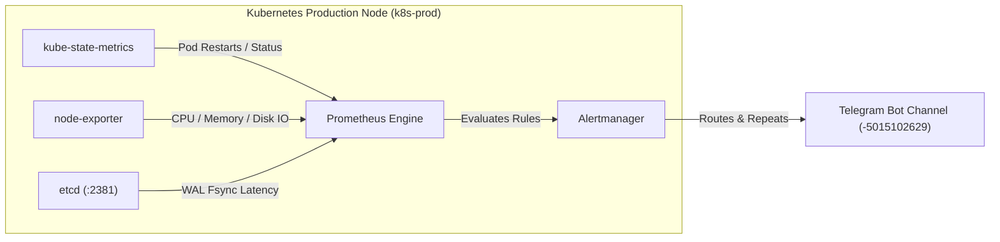

# 🚀 Tài Liệu Triển Khai: Hệ Thống Giám Sát & Cảnh Báo Hạ Tầng (Monitoring & Alerting Deployment)

Tài liệu này hướng dẫn chi tiết về cấu hình, kiến trúc và quy trình triển khai hệ thống giám sát Prometheus, Alertmanager và bộ quy tắc cảnh báo Telegram (Infrastructure Alert Rules) cho cụm Kubernetes Production.

---

## 1. Kiến Trúc Hệ Thống Giám Sát

Hệ thống sử dụng bộ Helm Chart `kube-prometheus-stack` quản lý bằng ArgoCD (GitOps) tại namespace `monitoring`.



---

## 2. Quy Tắc Cảnh Báo Hạ Tầng (Prometheus Rules)

Hệ thống được cấu hình 2 nhóm Prometheus Rules chính trong `additionalPrometheusRulesMap`:

### 2.1. Nhóm 1: Controller & Etcd Health (`controller-etcd.rules`)

1. **`ControllerContainerFrequentRestarts`** (Severity: `warning`):
   * **Mục đích**: Phát hiện Controller/Operator bị restart lặp lại $\ge 3$ lần trong 10 phút.
   * **PromQL**: `increase(kube_pod_container_status_restarts_total{namespace=~"kube-system|doppler-operator-system|argocd"}[10m]) >= 3`
2. **`EtcdWalFsyncLatencyHigh`** (Severity: `warning`):
   * **Mục đích**: Cảnh báo đợt tăng độ trễ ghi đĩa etcd WAL fsync p99 vượt quá 500ms (nguyên nhân gây timeout Leader Lease).
   * **PromQL**: `histogram_quantile(0.99, rate(etcd_disk_wal_fsync_duration_seconds_bucket[5m])) > 0.5`
3. **`ControllerDownLongDuration`** (Severity: `critical`):
   * **Mục đích**: Cảnh báo khẩn cấp khi Controller bị Not Ready / Down kéo dài quá 5 phút.
   * **PromQL**: `kube_pod_status_phase{...} == 1 or kube_pod_container_status_running{...} == 0`

### 2.2. Nhóm 2: Node Resource & I/O Health (`node-health.rules`)

1. **`NodeLoadHighWarning` & `NodeLoadHighCritical`**:
   * **Mục đích**: Cảnh báo tải hệ thống tính chuẩn theo số vCPU Cores (3 cores).
   * **PromQL Warning**: `(node_load5 / count count without (cpu, mode) (node_cpu_seconds_total{mode="idle"})) >= 1.0` (Load5 $\ge 3.0$).
   * **PromQL Critical**: Tỷ lệ Load/Core $\ge 1.5$ (Load5 $\ge 4.5$).
2. **`NodeCpuUsageHighWarning`**:
   * **Mục đích**: CPU Node bận $> 80\%$ trong 5 phút.
3. **`NodeMemoryUsageHighWarning` & `NodeMemoryUsageHighCritical`**:
   * **Mục đích**: RAM Node sử dụng $> 85\%$ (Warning) hoặc $> 95\%$ (Critical / Nguy cơ OOM).
4. **`NodeDiskSpaceHighWarning`**:
   * **Mục đích**: Dung lượng đĩa root (`/`) sử dụng $> 85\%$.
5. **`NodeDiskIoUtilizationHigh` & `NodeDiskIoLatencyHigh`**:
   * **Mục đích**: Cảnh báo ổ đĩa bận I/O liên tục $> 85\%$ thời gian hoặc độ trễ I/O Await $> 50\text{ms}$.

---

## 3. Chiến Lược Điều Hướng Cảnh Báo (Alertmanager Routing)

Cấu hình điều hướng tin nhắn trong Alertmanager giúp tránh rác tin nhắn (Spam) đồng thời đảm bảo không bị bỏ quên sự cố:

* **Mức `info`**: Điều hướng sang receiver `null` (Tắt tin nhắn Telegram, chỉ lưu metric).
* **Mức `warning`**: Đẩy tin nhắn về Telegram, cài đặt **`repeat_interval: 2h`** (Nhắc lại 2 tiếng/lần nếu chưa resolved).
* **Mức `critical`**: Đẩy tin nhắn về Telegram, cài đặt **`repeat_interval: 30m`** (Nhắc lại dồn dập 30 phút/lần cho tới khi xử lý xong).

---

## 4. Hướng Dẫn Triển Khai & Đồng Bộ GitOps

### Bước 4.1: Cấu hình GitOps Application
Tệp tin cấu hình: [kube-prometheus-stack.yaml](file:///d:/DATA/Portfolio/infra/argocd/applications/monitoring/kube-prometheus-stack.yaml)

### Bước 4.2: Lệnh đồng bộ qua ArgoCD
```bash
kubectl apply -f infra/argocd/applications/monitoring/kube-prometheus-stack.yaml
```

### Bước 4.3: Kiểm tra trạng thái triển khai
```bash
kubectl get application monitoring-kube-prometheus-stack -n argocd
kubectl get prometheusrules -n monitoring
```

---

## 5. Quy Trình Kiểm Thử Giả Lập Thủ Công (E2E Test Runbook)

Để kiểm tra kênh truyền tin nhắn Telegram từ Alertmanager:

1. **Gửi tin nhắn giả lập Cảnh báo (Firing Alert)**:
   ```bash
   Get-Content "scratch/test_alert_en.json" | ssh k8s-prod "curl -i -X POST -H 'Content-Type: application/json' -d @- http://10.0.0.181:9093/api/v2/alerts"
   ```
2. **Gửi tin nhắn giả lập Phục hồi (Resolved Alert)**:
   ```bash
   Get-Content "scratch/test_alert_en_resolved.json" | ssh k8s-prod "curl -i -X POST -H 'Content-Type: application/json' -d @- http://10.0.0.181:9093/api/v2/alerts"
   ```
